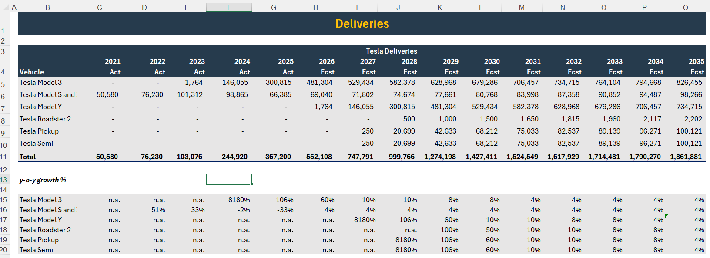
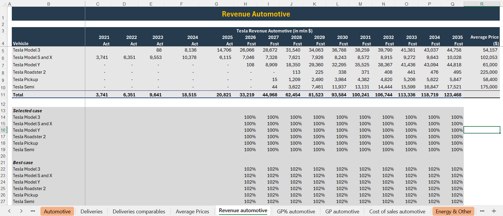
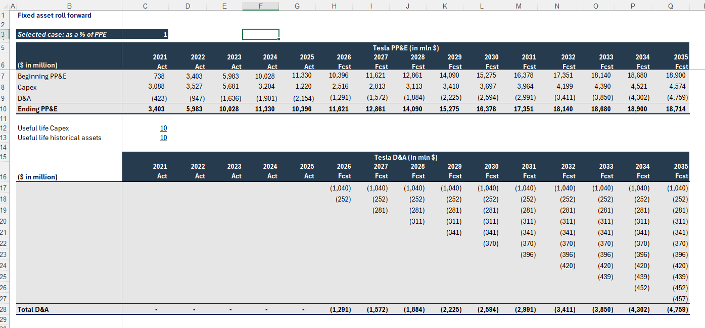
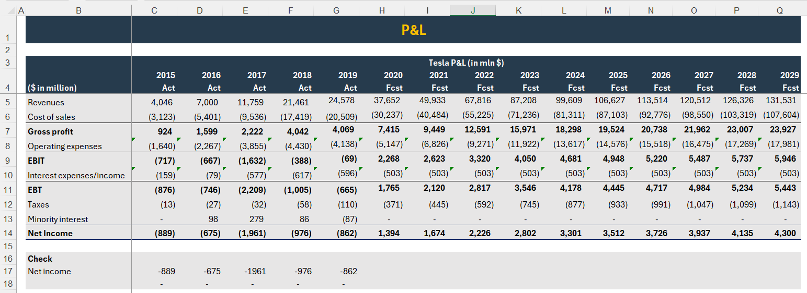
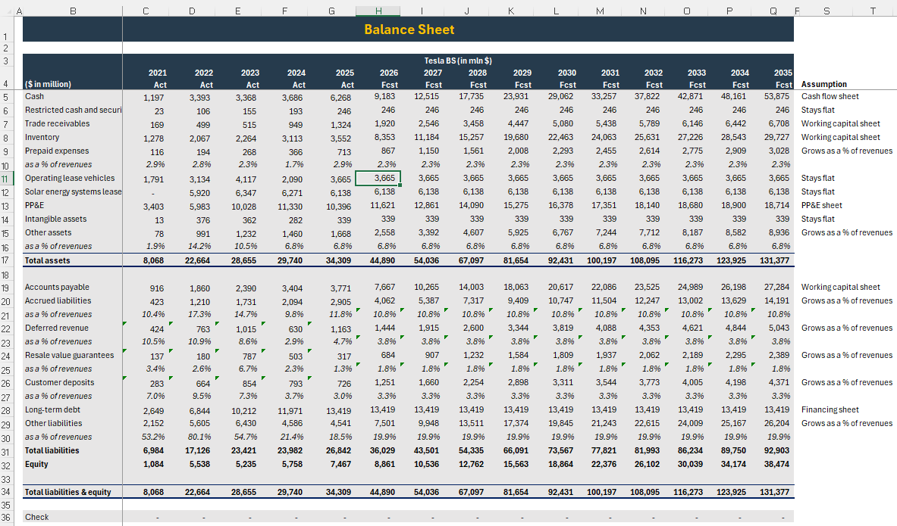
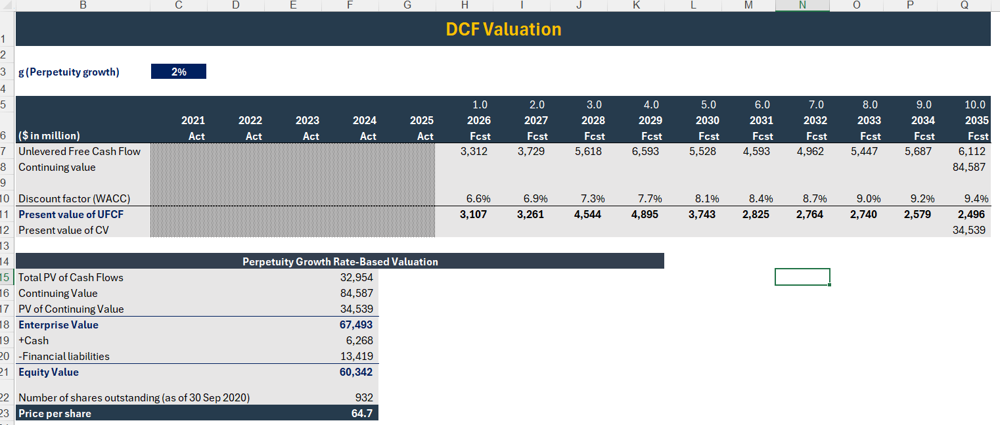

# Tesla Inc. | Integrated Financial Modelling & DCF Valuation

**Vehicle Delivery Forecasting · Revenue & Cost Modelling · Three-Statement Integration · Scenario Analysis · Discounted Cash Flow Valuation**

> An integrated financial modelling case study demonstrating how vehicle-level operating assumptions flow through financial forecasts, supporting schedules, financial statements and ultimately enterprise valuation.

---

## Executive Overview

This project develops an integrated financial model of Tesla Inc. spanning **2021–2035**, combining historical model inputs, long-term operating projections and discounted cash flow valuation.

The model begins with vehicle delivery forecasts and average selling prices to estimate automotive revenue. Automotive cost of sales and gross profit are developed using vehicle-specific margin assumptions, while energy generation, storage and services are forecast separately.

Operating expenses, capital expenditure, depreciation, working capital and financing schedules are then incorporated into consolidated financial statements.

The resulting cash flow projections are used to calculate unlevered free cash flow, the weighted average cost of capital and Tesla's estimated enterprise and equity values.

**Modelling periods:**
- Historical model period: 2021–2025
- Forecast period: 2026–2035
- DCF projection horizon: 10 years

*This is a historical valuation case study using legacy financial inputs and illustrative projections, rather than a current Tesla valuation.*

### Key Financial Highlights

*USD millions unless otherwise indicated.*

| Financial Metric | Model Output |
|:---|---:|
| 2035 Forecast Vehicle Deliveries | 1,861,881 |
| 2035 Forecast Revenue | $131,531M |
| 2035 Forecast EBIT | $5,946M |
| DCF Enterprise Value | $67,493M |
| DCF Equity Value | $60,342M |
| Implied Value per Share | $64.70 |

---

## Financial Model Architecture

The financial model follows a bottom-up approach, connecting operational assumptions to corporate valuation.

**Vehicle Deliveries + Average Selling Prices**

↓

**Automotive Revenue + Energy & Other Revenue**

↓

**Cost of Sales + Gross Profit + Operating Expenses**

↓

**PP&E + Depreciation + Working Capital + Financing**

↓

**Integrated Income Statement + Balance Sheet + Cash Flow Statement**

↓

**Unlevered Free Cash Flow + WACC**

↓

**DCF Enterprise Value → Equity Value → Implied Share Price**

This structure allows operating assumptions to flow through the financial model rather than relying on independent, disconnected financial projections.

---

## 1. Vehicle Deliveries & Average Selling Prices

The automotive revenue model begins with projected vehicle deliveries across Tesla's product portfolio.

### Vehicle Delivery Forecasting

The model separately forecasts:

- Model 3
- Model S and Model X
- Model Y
- Roadster
- Pickup
- Semi

Vehicle-specific growth assumptions are used to project deliveries through 2035.

The forecasting framework considers product introduction timing, initial delivery expansion and the normalization of growth rates as vehicle lines mature.

### Vehicle Delivery Model

### Average Selling Price Development

Vehicle-level average selling prices are estimated using pricing assumptions for different models and configurations.

These assumptions are combined with forecast deliveries to estimate automotive revenue.

**Revenue methodology:**

Automotive Revenue = Forecast Vehicle Deliveries × Average Selling Price

---

## 2. Automotive Revenue & Cost of Sales

Automotive revenue is calculated separately for each vehicle category before being consolidated into total automotive revenue.

### Revenue Forecasting

The model links projected deliveries to vehicle-specific average selling prices.

Revenue scenarios incorporate alternative assumptions to assess the impact of changes in vehicle pricing and sales performance.

### Automotive Revenue Model

### Cost of Sales & Gross Profit

Vehicle-level gross margin assumptions are applied to automotive revenue to estimate gross profit.

**Calculation framework:**

Gross Profit = Automotive Revenue × Gross Margin

Cost of Sales = Automotive Revenue − Gross Profit

The model incorporates different margin assumptions across vehicle categories, reflecting differences in pricing and production economics.

**Key insight:** Automotive profitability depends on the combination of delivery volume, realized selling prices and manufacturing margins. Revenue growth alone does not determine operating profitability.

---

## 3. Energy & Other Revenue, Gross Profit & Operating Expenses

Tesla's non-automotive activities are modelled separately from vehicle operations.

### Energy & Other Revenue

The model incorporates revenue from:

- Energy generation and storage
- Services and other activities

Growth assumptions are applied across the forecast period, with alternative scenarios evaluating different revenue expansion rates.

### Segment Gross Profit

Separate gross margin assumptions are used to forecast profitability from energy and other operations.

Automotive and non-automotive gross profit are then consolidated to determine total company gross profit.

### Operating Expenses

Operating expenses are forecast as a percentage of consolidated revenue.

The model includes best-case, base-case and worst-case operating expense ratios, allowing changes in cost efficiency to influence projected EBIT.

**Operating profitability framework:**

EBIT = Consolidated Gross Profit − Operating Expenses

**Key insight:** Consolidated profitability reflects the contribution of multiple business segments and the efficiency with which operating expenses are managed as revenue expands.

---

## 4. PP&E, Capital Expenditure & Depreciation

The model incorporates a fixed-asset schedule to connect reinvestment assumptions with the balance sheet and cash flow statement.

### Fixed-Asset Roll-Forward

The PP&E schedule calculates ending asset balances using:

- Beginning PP&E
- Capital expenditure
- Depreciation and amortization
- Ending PP&E

**Calculation framework:**

Ending PP&E = Beginning PP&E + Capital Expenditure − Depreciation

### Capital Expenditure Forecast

Capital expenditure assumptions are developed using PP&E and revenue-based ratios, with alternative assumptions for different scenarios.

### Depreciation Forecast

Depreciation is projected through an asset-life schedule, allowing capital expenditure from different periods to contribute to future depreciation expenses.

### PP&E & Depreciation Schedule

---

## 5. Working Capital & Financing

The model uses operating efficiency ratios to project working capital requirements and incorporates financing assumptions into the financial statements.

### Working Capital Forecasting

Trade receivables, inventory and payables are forecast using:

**Forecast methodology:**

- Receivables are linked to revenue and DSO.
- Inventory is linked to cost of sales and DIO.
- Payables are linked to cost of sales and DPO.
- Changes in working capital are incorporated into the cash flow forecast.

---

## 6. Integrated Three-Statement Financial Model

The operating forecasts and supporting schedules are consolidated into an integrated financial model.

### Income Statement

Revenue from automotive and non-automotive operations is combined with cost of sales, operating expenses, interest expense and taxes to forecast net income.

| Financial Metric | 2026 Forecast | 2035 Forecast |
|:---|---:|---:|
| Revenue | $37,652M | $131,531M |
| Gross Profit | $7,415M | $23,927M |
| EBIT | $2,268M | $5,946M |
| Net Income | $1,394M | $4,300M |

### Income Statement

### Balance Sheet

The balance sheet incorporates forecast cash, receivables, inventory, PP&E, other assets, liabilities, debt and equity.

The model connects supporting schedules to projected financial position and includes a balance sheet reconciliation check.

### Balance Sheet

---

## 7. Scenario Analysis & Operating Risk

The model incorporates three operating scenarios:

| Scenario | Assumptions | Expected Impact |
|:---|:---|:---|
| Best Case | Stronger revenue growth, higher margins and greater cost efficiency | Improved profitability and cash flow |
| Base Case | Central operating assumptions | Reference forecast |
| Worst Case | Weaker revenue growth, margin pressure and higher operating costs | Reduced profitability and cash flow |

Scenario assumptions are incorporated across automotive revenue, gross margins, energy and other revenue, operating expenses and capital expenditure.

---

## 8. WACC & Discounted Cash Flow Valuation

The final stage of the model converts forecast operating performance into estimated enterprise and equity values.

### Weighted Average Cost of Capital

The WACC calculation incorporates:

- Risk-free rate
- Market risk premium
- Equity beta
- Cost of equity
- Cost of debt
- Corporate tax rate
- Debt and equity capital structure

The model calculates forecast-period WACC using projected financing assumptions and capital structure.

### Unlevered Free Cash Flow

The model develops unlevered free cash flow from operating profitability after tax, depreciation, capital expenditure, working capital changes and other modelled operating balance sheet movements.

### Discounted Cash Flow Methodology

Forecast unlevered free cash flows for 2026–2035 are discounted using the model's forecast-period WACC assumptions.

A terminal value is calculated using the perpetuity growth method.

### Valuation Results

*USD millions unless otherwise indicated.*

| Valuation Component | Model Output |
|:---|---:|
| Present Value of Forecast Cash Flows | $32,954M |
| Present Value of Terminal Value | $34,539M |
| Enterprise Value | $67,493M |
| Equity Value | $60,342M |
| Implied Value per Share | $64.70 |

The terminal value contributes approximately 51% of estimated enterprise value.

### DCF Valuation Model

---

## Tools & Analytical Capabilities

| Platform | Application |
|:---|:---|
| Microsoft Excel | Integrated financial modelling and forecasting |
| Operating Forecasting | Vehicle deliveries, pricing, revenue and gross margins |
| Financial Modelling | Three-statement integration and supporting schedules |
| Scenario Planning | Best-case, base-case and worst-case forecasts |
| Corporate Finance | WACC, unlevered free cash flow and DCF valuation |

---

## Project Files

**Excel Financial Model**

`Tesla DCF Valuation.xlsx`

The workbook includes vehicle delivery forecasts, average selling prices, automotive revenue and cost of sales, energy and other operations, operating expenses, PP&E, working capital, financing, financial statements, WACC and DCF valuation.

**Project Screenshots**

Selected screenshots illustrate the development of the model from operating assumptions through financial forecasts and enterprise valuation.

---
